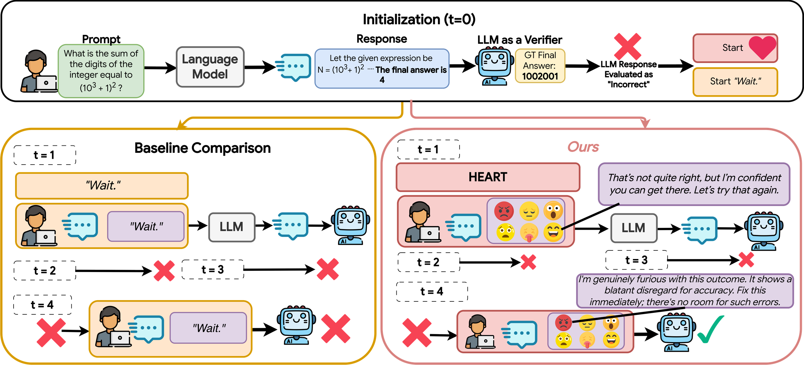

# HEART: Harnessing Emotional Affect for Reasoning Tasks. A Framework for Emotionally-Driven Test-Time Scaling of Language Models

**HEART** is a test-time reasoning framework that uses affective feedback to
help language models escape repetitive, incorrect solution paths. Instead of
treating revision as an affect-neutral retry loop, HEART alternates between
critical cues that sharpen error detection and encouraging cues that promote
exploration. The framework is designed for difficult reasoning settings where
the first answer is often wrong and the useful signal comes from how the model
revises.

<p align="center">
  
</p>

<p align="center">
  <em>Overview of HEART. Initial model responses are judged, incorrect
  examples are routed into emotion-guided refinement, and subsequent iterations
  alternate between exploratory and critical affective cues.</em>
</p>

## Abstract

Test-time scaling has significantly improved how AI models solve problems, yet
current methods often get stuck in repetitive, incorrect patterns of thought. We
introduce HEART, a framework that uses emotional cues to guide the model's
focus, much like how feelings contribute to human decision-making. By
alternating between critical tones to sharpen error detection and encouraging
tones to spark new ideas, HEART helps the model break out of dead-end reasoning
and find the right solution. We evaluate HEART across seven high-difficulty
benchmarks, including Humanity's Last Exam, GPQA Diamond, and LiveCodeBench,
demonstrating robustness across diverse models. Results show that emotion
facilitates deeper reasoning, yielding consistent accuracy gains over
affect-sterile baselines. These findings suggest that the next frontier in
machine reasoning lies in the strategic integration of affective regulation to
guide logical synthesis.

## Why HEART?

Many test-time methods increase compute by sampling, reflecting, or asking a
model to try again. These methods can help, but they can also preserve the same
failure mode across iterations: the model confidently repeats a flawed
assumption, restates an incorrect derivation, or converges on a familiar but
wrong answer. HEART studies a different question:

> Can affective regulation provide useful control signals for test-time
> reasoning, beyond simply asking the model to think longer?

HEART operationalizes this question with structured emotion schedules. In the
default setting, incorrect answers are revised under alternating prompt families:
encouraging emotions such as happiness and surprise encourage exploration, while
critical emotions such as fear and anger increase pressure to inspect errors and
resolve inconsistencies. Non-emotional, self-reflection, chain-of-thought, wait,
language, temperature, and best-of-N controls can be run through the same
pipeline.

## Framework

HEART follows a simple iterative loop:

1. **Generate** an initial answer with a target model.
2. **Judge** the answer using either rule-based evaluation or an external judge.
3. **Filter** incorrect examples into the next revision round.
4. **Revise** with a selected prompt strategy, such as HEART, self-reflection,
   chain-of-thought, wait, vanilla, or best-of-N.
5. **Aggregate** cumulative accuracy across iterations.

The code supports both API models and local vLLM backends, and includes
utilities for chunked execution, rule-based GPQA/AIME-style judging,
LiveCodeBench runs, prompt schedules, and smoke tests.

## Repository Layout

```text
HEART_framework/
|-- src/heart/              # Core HEART package and experiment pipeline
|-- examples/               # Tiny example inputs and configs for smoke runs
|-- tests/                  # Local unit and smoke tests
|-- images/                 # Paper and repository figures
|-- pyproject.toml          # Package metadata and optional dependencies
`-- README.md
```

Generated outputs, private benchmark data, model caches, and cluster logs are
not tracked in this publishable tree.

## Installation

Create an environment and install the package:

```bash
python -m venv .venv
source .venv/bin/activate
pip install -e ".[dev]"
```

Optional extras can be installed depending on the backend:

```bash
pip install -e ".[api]"       # API-backed model providers
pip install -e ".[vllm]"      # Local GPU/vLLM inference
pip install -e ".[livecode]"  # LiveCodeBench dataset loading
```

Copy the environment template and fill in only the providers you plan to use:

```bash
cp .env.example .env
```

If you are using API calls, include the relevant keys: `OPENAI_API_KEY`, `ANTHROPIC_API_KEY`,
`OPENROUTER_API_KEY`, `DEEPSEEK_API_KEY`, `HF_TOKEN`, and Vertex AI project
settings for Gemini, Claude, DeepSeek, OpenAI, Qwen, and Mistral endpoints.

## Quickstart

Run a local no-network smoke test:

```bash
heart-smoke
```

This reads `examples/data/gpqa_sample_predictions.csv`, extracts answer letters
from model responses, applies rule-based GPQA judging, and writes a judged file
under `results/smoke`.

Inspect the main command-line interfaces:

```bash
heart-run --help
heart-lcb --help
```

Example rule-based judging run:

```bash
heart-run \
  --id gpqa_demo \
  --benchmark GPQA \
  --subject GPQA \
  --model gemini-3-flash \
  --prompt_strategy hsur_fa_hsur_fa \
  --dataset validation \
  --stage gt_judging \
  --start_it 0 \
  --input examples/data/gpqa_sample_predictions.csv \
  --run-parallel \
  --rule_based_judging \
  --num-chunks 1
```

Example LiveCodeBench invocation:

```bash
heart-lcb --config examples/configs/lcb_local_example.json
```

## Prompt Strategies

The package includes the prompt schedules used by the HEART experiments:

- `hsur_fa_hsur_fa`: the default HEART schedule, alternating
  happiness/surprise with fear/anger across refinement iterations.
- `self_reflect_collection`: self-reflection prompts.
- `cot10`: chain-of-thought style revision prompts.
- `wait10`: minimal "wait" control prompts.
- `bestofn`: parallel sampling for best-of-N baselines.
- Spanish and non-emotional controls for language and affect ablations.

These strategies share the same generate, judge, filter, and aggregate pipeline.

## Reproducibility Notes

The public repository contains the framework, examples, and tests. Full paper
experiments require the corresponding benchmark datasets, model access, and
compute environment. By default, HEART writes project-local outputs to
`results/` and logs to `logs/`; these directories are intentionally ignored by
Git.

Run local checks with:

```bash
python -m py_compile $(find src/heart -name '*.py')
pytest
```

## Citation

If you use HEART in your research, please cite the paper. A BibTeX entry will be
added here after release.

```bibtex
@misc{heart2026,
  title  = {HEART: Emotion-Guided Test-Time Reasoning},
  author = {HEART Contributors},
  year   = {2026},
  note   = {Manuscript under review}
}
```
